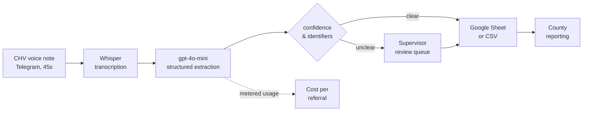

# chw-voice-pipeline

Community health referrals captured by voice note, transcribed, and written into the Kenya MOH-100 form as structured data. **KES 0.61 in API cost per referral**, reproducible with `python scripts/unit_cost.py`.

---

## The problem

MOH-100 is the Kenya Ministry of Health community referral form. A community health volunteer fills one when they send a client from the household to a health facility. It carries 22 fields across four blocks.

In practice it is paper. It is filled at the end of a long day, often by torchlight, and it reaches the facility days later if it reaches it at all. The standard fix is a smartphone app, and the standard app assumes literacy in English, a charged device, a data bundle, and the patience to complete 22 form fields on a small screen. In Kenya's community health system those assumptions do not hold uniformly, which is why digital referral tools keep producing good pilot data and poor routine data.

A voice note assumes almost none of that. The CHV speaks for forty-five seconds in whatever mixture of English and Swahili they normally use, and the structuring happens downstream where the constraints are money rather than literacy, battery or airtime.

This repository is the downstream part.

## What it does

- **Takes a voice note over Telegram**, because Telegram is already installed, works on low bandwidth, and queues messages until signal returns rather than failing.
- **Transcribes and extracts** into the 22 MOH-100 fields, translating Swahili values into English for storage while leaving names, places and clinical descriptions in the speaker's own terms.
- **Routes uncertain records to a human** instead of guessing. A referral the model was unsure about is flagged before it reaches a report.

## Architecture



Sheets rather than a database is a deployment decision, not a technical preference. The binding constraint at sub-county level is who administers the system after the project ends, and a county team that already runs Google Workspace can maintain a spreadsheet without anyone being seconded to it.

## Unit economics

The claim is that this costs under one Kenyan shilling per referral. That is only worth anything if you can check it, so it is computed from metered usage rather than asserted. `src/costs.py` takes the actual audio duration and the token counts the API returns; on a live run the reported figure is what that run cost.

```
One referral (45s audio, 520 in / 300 out)
  transcription      $0.004500
  extraction         $0.000258
  total              $0.004758  =  KES 0.614

At 10,000 referrals a month
  $47.58 / month   KES 6,138 / month
```

Rates are in `src/config.py` and overridable by environment variable, so the figure recomputes against current pricing rather than the pricing on the day it was measured (1 September 2026: `whisper-1` $0.006/min, `gpt-4o-mini` $0.15 and $0.60 per million tokens).

Transcription is roughly 95 percent of the cost, which is the useful finding. Effort spent shortening prompts is wasted. Effort spent keeping recordings short, or moving to a cheaper transcription model, is not.

**This is the API cost and nothing else.** It is not the cost of running a referral system. It excludes hosting, connectivity, supervisor review time, CHV airtime, training, support and implementation, and every one of those is larger. The figure is useful for one specific question, which is whether per-transaction inference pricing rules the approach out at county scale. It does not. It answers nothing about total cost of ownership, and anyone quoting it as a programme cost is quoting it wrongly.

### Model lifecycle

Checked 25 November 2026. **Both default models are deprecated.**

| Model | Status | Shutdown | Replacement named by OpenAI |
| --- | --- | --- | --- |
| `whisper-1` | Deprecated, notice 26 Aug 2026 | 26 Feb 2027 | `gpt-transcribe` or `gpt-live-transcribe` |
| `gpt-4o-mini-2024-07-18` | Deprecated, notice 14 Oct 2026 | 14 Jan 2027 | `gpt-6-luna` |

This is recorded rather than quietly patched, because the gap between how fast models are retired and how slowly a health programme can revalidate a pipeline is the actual deployment problem, not a footnote to it. A county that validated this pipeline in September would have had roughly five months before its transcription model was switched off.

What that means in practice:

- **Nothing here breaks today.** The offline path, the tests and the cost model never call an API. Live runs keep working until the shutdown dates above.
- **Both models are config, not code.** `TRANSCRIPTION_MODEL` and `EXTRACTION_MODEL` in `.env` change them without touching `src/`.
- **Re-measure before quoting the figure.** `gpt-6-luna` is published at $0.05 and $0.25 per million tokens, cheaper than `gpt-4o-mini`, so extraction gets cheaper. A per-minute price for `gpt-transcribe` is not published on the pricing page, and since transcription is 95 percent of the cost, the headline figure is only as current as that number. Run `python scripts/unit_cost.py` with the rates you are actually billed at.

## Run it

Offline, no API key, no spend. This is the full path apart from the two API calls:

```bash
git clone https://github.com/wachisai/chw-voice-pipeline
cd chw-voice-pipeline
pip install -r requirements.txt

python scripts/run_local.py --offline data/synthetic/003.txt
python scripts/unit_cost.py
python -m pytest -q
```

`003` is the recording where the CHV does not know the client's name. It is in the corpus because that case matters more than the clean ones.

```
Confidence      0.34
Unclear fields  patient.patient_name, patient.sex, patient.age_years, patient.village
Review needed   YES
Cost            transcription $0.00136 + extraction $0.00026 = $0.00162 (KES 0.209)
```

Live, against the APIs:

```bash
cp .env.example .env        # add OPENAI_API_KEY and TELEGRAM_BOT_TOKEN
python scripts/run_local.py path/to/voice-note.ogg
python -m src.bot           # then send the bot a voice note
```

## The comparison

`demo/index.html` is the MOH-100 form as a web form, with a timer. It is the control condition. Open it, fill all 22 fields the way a CHV would at the end of a shift, and compare the elapsed time against a forty-five second voice note.

The point of the demo is not that typing is slow. It is that the 22-field form is what currently gets skipped, and a system nobody completes produces no data at all.

## What this does not do

Stated plainly, because the limitations decide whether this is deployable and the strengths do not.

- **It is not validated against clinical outcomes.** Nothing here has been evaluated for whether it changes referral completion, time to treatment, or anything a patient would notice. It is a data capture pipeline, not an intervention with evidence behind it.
- **It is not a medical device and makes no clinical judgement.** The extraction prompt forbids converting a description into a diagnosis. "Homa kali kwa siku tatu" is stored as stated, not as suspected malaria. Triage stays with the clinician.
- **Transcription quality is uneven across the languages that matter most.** Whisper handles Kenyan English well, Swahili adequately, and Sheng and strong regional accents poorly. The vocabulary hint in `src/transcribe.py` helps and does not solve it. Any real deployment needs a measured word error rate per site before anyone relies on the output.
- **There is no data protection layer.** Real referrals are patient data under the Kenya Data Protection Act 2019. Running this on live referrals requires a lawful basis, a data processing agreement with the API provider, retention rules, and a registered data controller. None of that is in this repository, and the `.gitignore` exists to stop captured records ever reaching a commit.
- **The Apps Script endpoint is open by deployment default.** Anyone with the URL can append rows. Fine for a demonstration, not for production. `apps_script/Code.gs` says so at the top.
- **The offline extractor is not an extractor.** `FixtureExtractor` replays hand-checked golden files for the synthetic corpus so the plumbing can be tested without spend. It answers only for transcripts it has already seen, and raises otherwise.
- **The corpus is synthetic.** The five transcripts in `data/synthetic` were written to be realistic, including the code-switching and the incomplete one. No real referral, real patient, or real CHV appears anywhere in this repository.

## Layout

```
src/schema.py       MOH-100 fields. Single source of truth for the form,
                    the extraction schema, the sheet header and the tests.
src/transcribe.py   Whisper, plus an offline stand-in.
src/extract.py      Transcript to structured record. The no-inference rule
                    lives in the system prompt here.
src/costs.py        Unit economics from metered usage.
src/sinks.py        CSV and Google Sheets.
src/pipeline.py     Orchestration.
src/bot.py          Telegram entry point.
apps_script/        The nine lines that receive a row into a spreadsheet.
demo/index.html     The paper form as a timed web form. The control condition.
data/synthetic/     Five transcripts with hand-checked expected extractions.
tests/              20 tests, no network, no key.
```

## Licence

MIT. See [LICENSE](LICENSE).

Built by [Wachira Ngatia](https://wachisai.github.io). Personal work, outside any client engagement.
